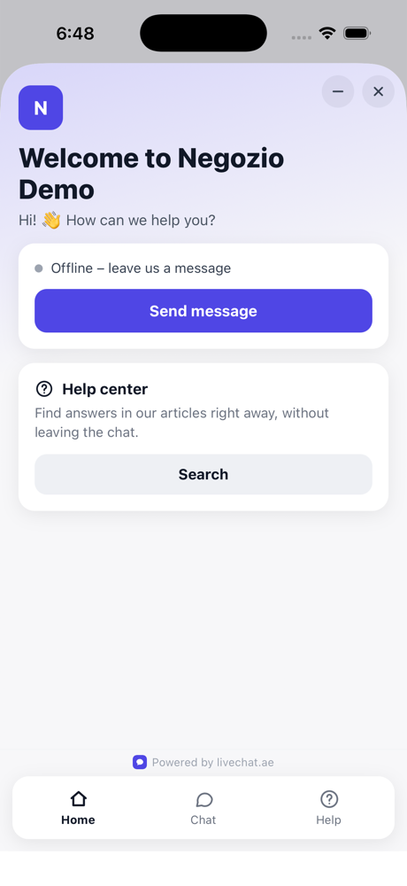
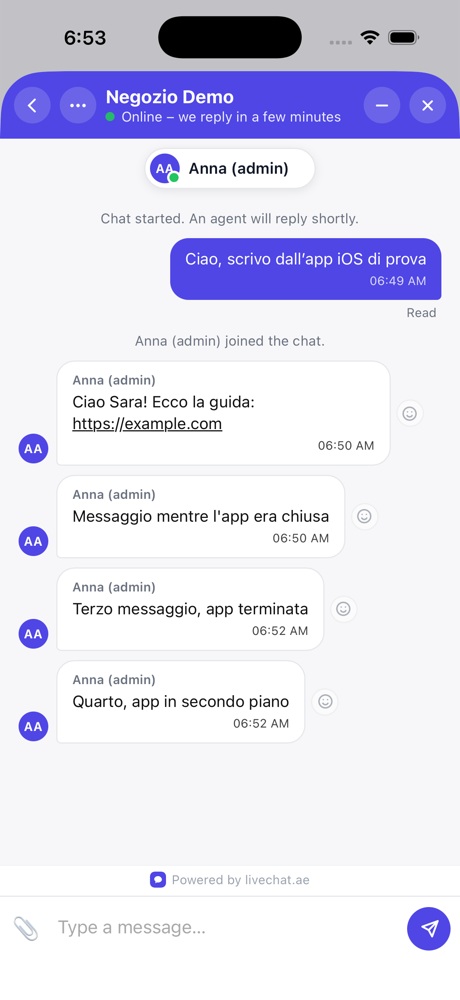
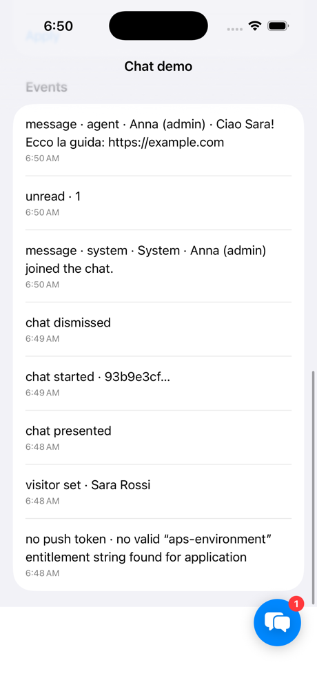

# livechat.ae iOS SDK

Add the livechat.ae chat to your iPhone and iPad app. The users of your app chat with your
team exactly like the visitors of your website: same agents, same settings, same pre-chat and
post-chat forms, departments, languages, knowledge base, attachments and ratings.

- Swift, iOS 15 or later, UIKit and SwiftUI
- One line to set up, one line to open the chat, a ready-made chat button with the unread badge
- Visitor name, email, custom fields and identity token from your app
- Events: new message, unread count, chat opened and closed, conversation started and ended, errors
- Push notifications when the app is closed, sent by your server through the `chat.agent_message` webhook

<p>
  
  
  
</p>

## Requirements

- iOS 15.0+ (iPhone and iPad)
- Xcode 15+ and Swift 5.9+
- A livechat.ae account and its **widget key**: the same `data-key` as in the website snippet,
  in **Admin › Installation**

## Installation

### Swift Package Manager

In Xcode choose **File › Add Package Dependencies…**, enter the repository address of the SDK and
add the **LiveChatAE** library to your app target. In a `Package.swift`:

```swift
dependencies: [
    .package(url: "https://github.com/gatehillsreg/livechat-ios-sdk.git", from: "1.0.0")
],
targets: [
    .target(name: "YourApp", dependencies: [.product(name: "LiveChatAE", package: "livechat-ios-sdk")])
]
```

### CocoaPods

```ruby
pod 'LiveChatAE', '~> 1.0'
```

## Quick start

Configure the SDK once at launch. The chat loads in the background, so messages and the unread
count arrive even before the user opens it.

```swift
import LiveChatAE

// UIKit: in application(_:didFinishLaunchingWithOptions:)
// SwiftUI: in the init() of your App
LiveChatAE.configure(key: "YOUR-WIDGET-KEY")
```

Open the chat from anywhere:

```swift
LiveChatAE.present()                 // from the top-most view controller
LiveChatAE.present(from: self)       // or from a view controller of yours
LiveChatAE.dismiss()                 // close it from code
```

Or drop in the ready-made button, with the unread badge:

```swift
// SwiftUI
SomeView()
    .overlay(alignment: .bottomTrailing) { LiveChatAEChatButton().padding() }

// UIKit
let button = LiveChatAEButton()      // 60×60 points, uses the tint color (or set button.color)
view.addSubview(button)
```

The chat opens as a sheet (a centered window on iPad). For a full-screen chat:

```swift
LiveChatAE.presentationStyle = .fullScreen
```

The visitor closes the chat with the **–** button in its header or by swiping it down. The
conversation goes on: new messages keep arriving and are counted as unread.

## Configuration

```swift
LiveChatAE.configure(
    key: "YOUR-WIDGET-KEY",
    language: "it",              // it, en, es, fr, de, ar, ru. Default: your account's language, then the device's
    department: "Sales"          // department for new chats. Default: the visitor chooses
)

LiveChatAE.setDepartment("Support")  // change it later, for the next chats
```

Calling `configure` again with different values reloads the chat.

## The signed-in user

If your app knows who the user is, pass it on: the pre-chat form is filled in, and agents see
who they are talking to.

```swift
LiveChatAE.setVisitor(name: "Sara Rossi", email: "sara@example.com")

// shown to agents next to the chat (up to 20 fields)
LiveChatAE.setCustomFields(["plan": "Gold", "customerId": "C-1042"])

// identity token signed by your server (same as LiveChatAE.identify on the website):
// livechat.ae passes it to your remote (AI) agents, which verify it
LiveChatAE.identify(token: tokenFromYourServer)
```

When the user signs out, forget them and their conversation on this device:

```swift
LiveChatAE.identify(token: nil)
LiveChatAE.reset()
```

## Events

Use a delegate (every method is optional) …

```swift
final class ChatEvents: LiveChatAEDelegate {
    func liveChat(didReceive message: LiveChatAEMessage) {
        print(message.sender, message.author, message.text)
    }
    func liveChat(unreadCountDidChange count: Int) { tabBarItem.badgeValue = count > 0 ? "\(count)" : nil }
    func liveChatDidPresent() {}
    func liveChatDidDismiss() {}
    func liveChat(didStartChat chatId: String) {}
    func liveChat(didEndChat chatId: String) {}
    func liveChat(didFailWith error: LiveChatAEError) { print(error) }
}

let events = ChatEvents()            // keep a strong reference: the delegate is weak
LiveChatAE.delegate = events
```

… or closures:

```swift
LiveChatAE.onMessage = { message in … }
LiveChatAE.onUnreadCountChange = { count in … }
LiveChatAE.onPresent = { … }
LiveChatAE.onDismiss = { … }
LiveChatAE.onChatStarted = { chatId in … }
LiveChatAE.onChatEnded = { chatId in … }
LiveChatAE.onError = { error in … }
```

In SwiftUI, observe the state directly:

```swift
@ObservedObject var chat = LiveChatAEState.shared

Text("Unread: \(chat.unreadCount)")      // also isPresented, agentsOnline, lastError
```

`LiveChatAE.unreadCountDidChangeNotification` is posted too, with the new count as `object`.

| Event | When |
|---|---|
| `didReceive message` | A new message: from an agent, an AI agent or an automation (`.agent`), from the visitor (`.visitor`) or a notice (`.system`). Arrives also while the chat window is closed, as long as the app is in the foreground |
| `unreadCountDidChange` | Agent messages not seen yet. Kept when the app is closed and opened again |
| `didPresent` / `didDismiss` | The chat window opened / closed |
| `didStartChat` | The visitor sent the first message, reopened a closed chat, or an agent invited them |
| `didEndChat` | The conversation was closed by the agent, the visitor or for inactivity |
| `didFailWith` | `.invalidKey`, `.network`, `.http`, `.configurationFailed`, `.disabled`, `.chatStartFailed`, `.tooManyChats`, `.notConfigured` |

## Links and attachments

Links and attachments tapped in the chat open inside your app, in a Safari view. To open them
in Safari (or in the app that handles them), or to handle them yourself:

```swift
LiveChatAE.linkHandling = .external
LiveChatAE.linkHandling = .custom { url in /* your code */ }
```

`mailto:`, `tel:` and other non-web links always go to the system.

## Push notifications

When the app is closed, the chat is not connected. To let the user know that an agent answered,
your server sends a push notification with your own APNs (or Firebase, OneSignal…) credentials:
livechat.ae tells your server when to send it and to which device.

**1. In the app**, register for remote notifications as usual and give the device token to the SDK:

```swift
func application(_ application: UIApplication, didRegisterForRemoteNotificationsWithDeviceToken deviceToken: Data) {
    LiveChatAE.setPushToken(deviceToken)
}
```

**2. In livechat.ae**, open **Admin › API & webhooks** and add a webhook for the event
**Reply to the visitor** (`chat.agent_message`), pointing to your server.

**3. On your server**, verify the signature of the webhook (see the
[webhook documentation](https://developers.livechat.ae/webhooks)) and send the push when the
visitor is not connected:

```json
{
  "event": "chat.agent_message",
  "data": {
    "chat": { "id": "93b9e3cf-…", "status": "active", "visitor": { "name": "Sara Rossi", "email": "sara@example.com" } },
    "message": { "id": 1042, "text": "Your order ships today.", "author": "Anna", "createdAt": "2026-11-24T06:50:12Z" },
    "visitor": { "online": false },
    "push": { "platform": "ios", "token": "a1b2c3d4…" }
  }
}
```

```js
// Node.js, with your APNs library of choice
if (!data.visitor.online && data.push?.platform === 'ios') {
  await apns.send(data.push.token, {
    aps: { alert: { title: data.message.author, body: data.message.text }, sound: 'default', 'thread-id': data.chat.id },
    livechatae: { chatId: data.chat.id }        // lets the SDK recognize the notification
  });
}
```

`push` is present only when the chat runs in your app and the app registered the device.
Put the `livechatae` key in the payload, as above.

**4. Back in the app**, open the chat when the user taps the notification:

```swift
func userNotificationCenter(_ center: UNUserNotificationCenter, didReceive response: UNNotificationResponse,
                            withCompletionHandler completionHandler: @escaping () -> Void) {
    LiveChatAE.handleNotification(response.notification.request.content.userInfo)  // false for your other notifications
    completionHandler()
}
```

`LiveChatAE.isLiveChatNotification(_:)` tells you whether a notification is about the chat, for
example to hide the banner while the chat is already on screen.

## Privacy and Info.plist

- The chat lets the user send photos. If they can take one with the camera, add
  `NSCameraUsageDescription` to your Info.plist. Choosing from the library needs no permission.
- The conversation is kept on the device, in the web data of the app, so that it survives app
  restarts. `LiveChatAE.reset()` deletes it.
- While the app is in the background the connection to livechat.ae is closed: for agents, the
  visitor has left. It opens again, and fetches what arrived meanwhile, when the app comes back.

## How it works

The SDK shows the livechat.ae chat in a `WKWebView` (`https://livechat.ae/sdk/chat?key=…`),
like the chat on your website, and talks to it through a small JavaScript bridge. So every
setting and every new feature of the livechat.ae chat reaches your app without updating the SDK.
The web view stays alive, invisible, while the chat window is closed: that is how messages and
the unread count arrive at any time and the chat opens instantly.

The SDK identifies itself to the server as `livechat.ae-ios-sdk/1.0.0`.

## Example app

`Example/LiveChatAEExample.xcodeproj` is a small app with every feature of the SDK: open it in
Xcode, choose an iPhone or iPad simulator and run. By default it talks to a livechat.ae server
on your Mac (`http://localhost:8080`, widget key `demo`); change both in the **Account** section
of the app.

## Tests

```bash
swift test
```

runs the tests of the SDK on your Mac (configuration, events, JavaScript bridge).

## License

MIT. See [LICENSE](LICENSE).
